<p align="center">
  
</p>

<h1 align="center">Emanuele BDC (EmaF205)</h1>
<p align="center">
  <b>Creative Technologist & AI Systems Architect // Milan, Italy</b><br>
  <i>Generative systems, client-first web tools, sensory interfaces & editorial architectures.</i>
</p>

<p align="center">
  <a href="https://emaf205.com"></a>
  <a href="https://github.com/emaf205"></a>
  <a href="https://github.com/emaf205/emaf205/actions"></a>
</p>

---

## 🏛️ Architectural Manifesto

Digital craftsmanship operating at the convergence of **Swiss design discipline** and **frontier artificial intelligence**:

- **Anti-AI Slop & Radical Simplicity**: Eliminating conversational filler, generic card soup, and neon clichés. Every element exists with structural and typographical intention.
- **Client-Side Sovereignty**: Prioritizing zero-cloud, offline-first architectures (IndexedDB, Web Audio, Canvas, Service Workers). What can run privately in browser memory never touches remote servers.
- **Zero Framework Bloat**: Pure vanilla web standards (modern ES6+, semantic HTML5, CSS custom properties). Sub-100ms render speeds and negligible dependency footprints.
- **Forensic Execution**: Mathematical verification, strict quality gates, and surgical implementation.

---

## 🌟 Creative Projects Feed // Visual Timeline

> *A continuous, full-width visual feed of production web apps, sensory prototypes, and open-source tools.*

<p align="center">
  <a href="https://github.com/emaf205/EMAF205-skills">
    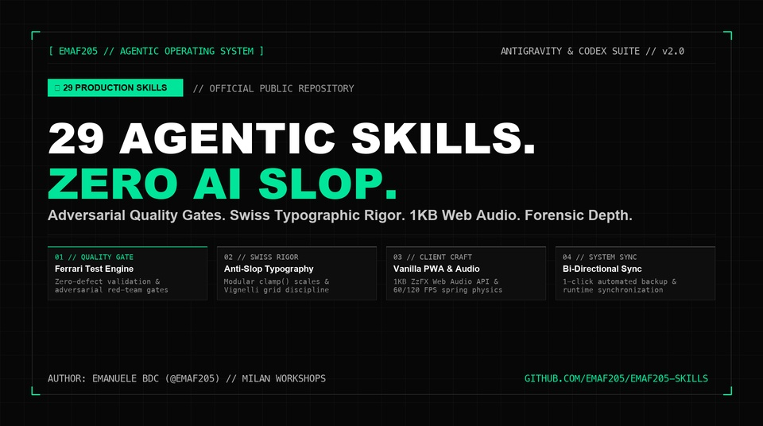
  </a>
</p>

### 1. [EMAF205 Skills // 29 Production Agentic Skills Suite](https://github.com/emaf205/EMAF205-skills)
`ANTIGRAVITY` `CODEX` `QUALITY GATES` `SWISS DESIGN` `WEB AUDIO` `AGENTIC OS`

> The official suite of 29 modular agentic skills for Google Antigravity & OpenAI Codex. Zero AI slop, adversarial Ferrari Test quality gates, Swiss modernist typography, 1KB procedural audio, and continuous automated synchronization.

<p><a href="https://github.com/emaf205/EMAF205-skills"></a> <a href="https://github.com/emaf205/EMAF205-skills#installation--usage"></a></p>

---

<p align="center">
  <a href="https://github.com/emaf205/silvo-tv">
    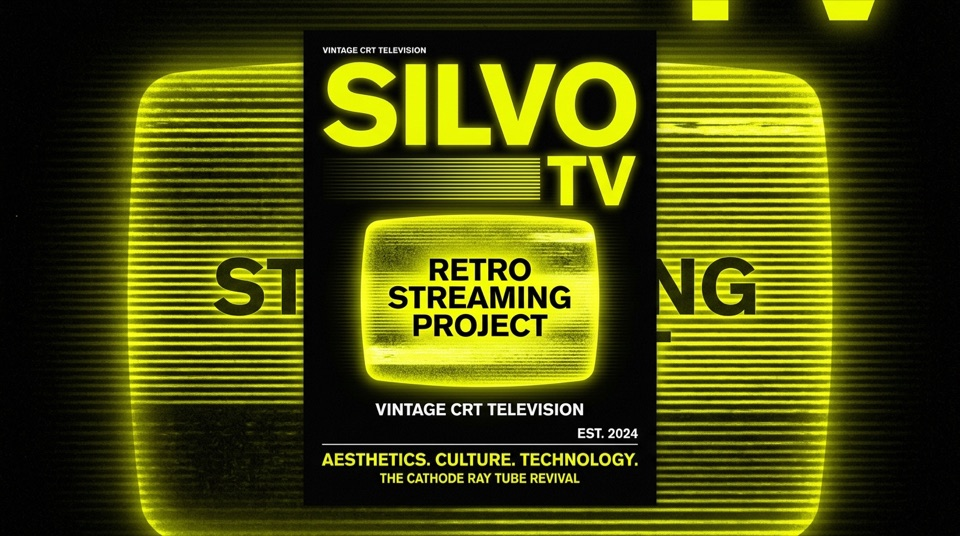
  </a>
</p>

### 2. [SILVO TV // Retro CRT Video Simulator](https://github.com/emaf205/silvo-tv)
`PWA` `RETRO CRT` `WEB AUDIO` `VANILLA JS`

> Interactive vintage cathode-ray tube television simulator with tactile rotary channel knobs, scanline shaders, and continuous broadcast of historical archives.

<p><a href="https://github.com/emaf205/silvo-tv"></a> <a href="https://emaf205.com/ideas/silvo-tv/"></a></p>

---

<p align="center">
  <a href="https://github.com/emaf205/EMAF205-Easy-ChatGPT-Importer">
    
  </a>
</p>

### 3. [Easy ChatGPT Importer // Offline JSON Archive Reader](https://github.com/emaf205/EMAF205-Easy-ChatGPT-Importer)
`PWA` `OFFLINE-FIRST` `JSON PARSER` `MARKDOWN EXPORT`

> Zero-cloud, client-side conversation explorer and markdown exporter for official OpenAI data exports. Sub-second full-text search across gigabytes of history.

<p><a href="https://github.com/emaf205/EMAF205-Easy-ChatGPT-Importer"></a> <a href="https://emaf205.com/ideas/chatgpt-importer/"></a></p>

---

<p align="center">
  <a href="https://github.com/emaf205/SIMPLE-PDF-SIGN">
    
  </a>
</p>

### 4. [Simple PDF Sign // In-Browser Cryptographic Signing](https://github.com/emaf205/SIMPLE-PDF-SIGN)
`PWA` `CRYPTOGRAPHY` `CANVAS` `ZERO SERVER`

> Pure browser-based digital document signing and cryptographic stamping utility. Zero server uploads, zero cloud dependencies, 100% private.

<p><a href="https://github.com/emaf205/SIMPLE-PDF-SIGN"></a> <a href="https://emaf205.com/ideas/simple-pdf-sign/"></a></p>

---

<p align="center">
  <a href="https://github.com/emaf205/ai-diary">
    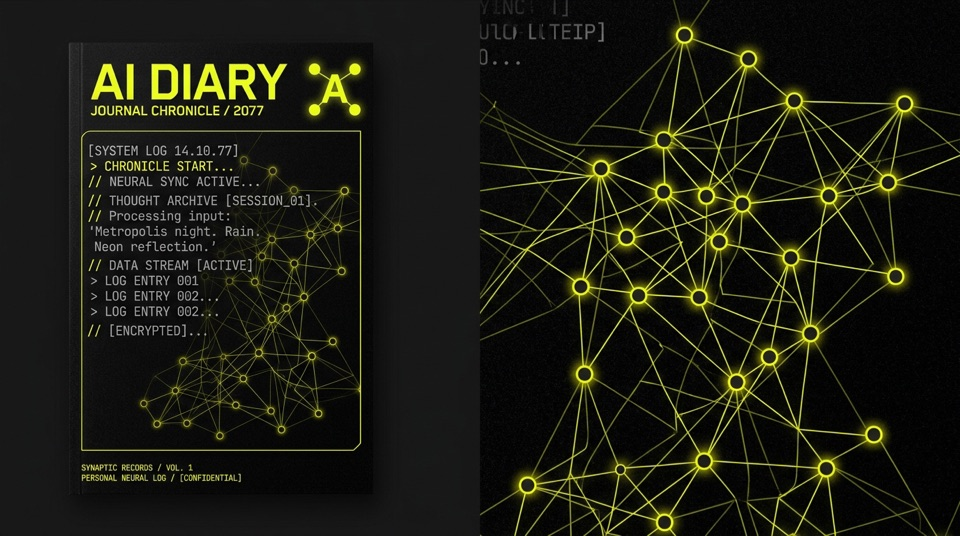
  </a>
</p>

### 5. [AI Diary // Encrypted Local-First Journal](https://github.com/emaf205/ai-diary)
`PWA` `INDEXEDDB` `LOCAL-FIRST` `ENCRYPTION`

> Private personal reflection diary and workflow chronicle with local IndexedDB storage, biometric lock simulation, and zero telemetry.

<p><a href="https://github.com/emaf205/ai-diary"></a> <a href="https://emaf205.com/ideas/ai-diary/"></a></p>

---

<p align="center">
  <a href="https://github.com/emaf205/kurt-cobain-street-critic">
    
  </a>
</p>

### 6. [Kurt Cobain Street Critic // Lo-Fi Grunge Zine](https://github.com/emaf205/kurt-cobain-street-critic)
`PWA` `LO-FI` `GRUNGE ZINE` `WEB AUDIO` `SATIRE`

> Photocopier halftone zine simulator and satirical street art critique engine. Caustic commentary on modern consumer aesthetics built with Web Audio.

<p><a href="https://github.com/emaf205/kurt-cobain-street-critic"></a> <a href="https://emaf205.com/ideas/kurt-critic/"></a></p>

---

<p align="center">
  <a href="https://github.com/emaf205/EASY-PERSONAL-LINKTREE">
    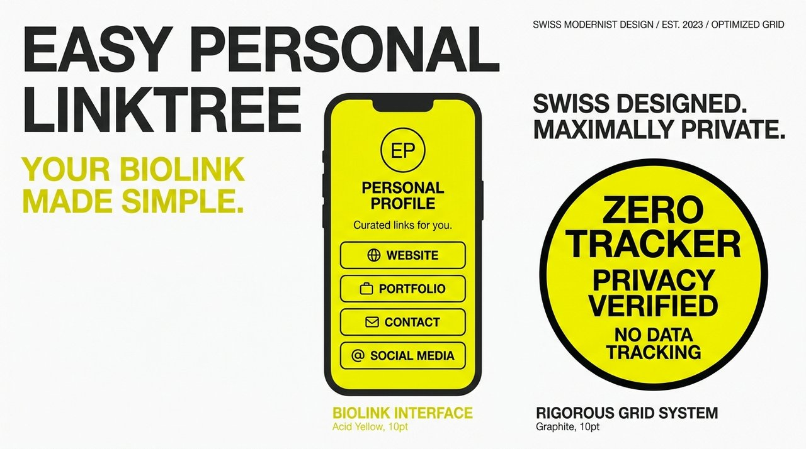
  </a>
</p>

### 7. [Easy Personal Linktree // High-Velocity Bio Link Hub](https://github.com/emaf205/EASY-PERSONAL-LINKTREE)
`MOBILE-FIRST` `ZERO BLOAT` `SUB-50MS` `VANILLA CSS`

> Uncompromising, zero-dependency bio link directory loading in under 50 milliseconds. Single-file architecture with tactile mobile touch ergonomcs.

<p><a href="https://github.com/emaf205/EASY-PERSONAL-LINKTREE"></a> <a href="https://linktr.ee/emaf205"></a></p>

---

<p align="center">
  <a href="https://github.com/emaf205/EmaF205-LinksX">
    
  </a>
</p>

### 8. [Links-X // High-Contrast Brutalist Directory](https://github.com/emaf205/EmaF205-LinksX)
`BRUTALISM` `HIGH-CONTRAST` `KEYBOARD NAV` `FAST WEB`

> High-contrast, hyper-fast personal link directory built with electric neon accents, obsidian black backgrounds, and zero framework bloat.

<p><a href="https://github.com/emaf205/EmaF205-LinksX"></a> <a href="https://emaf205.com/ideas/easy-links/"></a></p>

---

<p align="center">
  <a href="https://github.com/emaf205/emaf205-tapetone">
    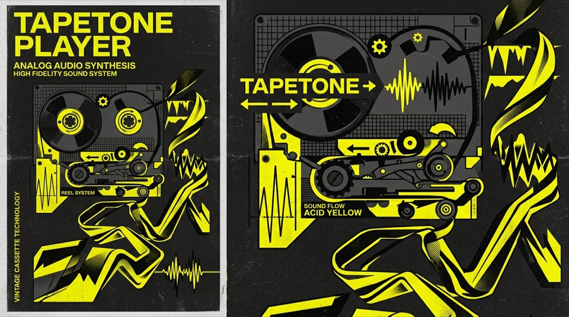
  </a>
</p>

### 9. [TapeTone // Analog Cassette Tape & Saturation Synth](https://github.com/emaf205/emaf205-tapetone)
`WEB AUDIO` `ANALOG SATURATION` `CASSETTE TAPE` `SYNTH`

> Warm analog acoustic saturation synthesizer and tape reel audio simulator modeling physical magnetic tape imperfections directly in browser memory.

<p><a href="https://github.com/emaf205/emaf205-tapetone"></a> <a href="https://emaf205.com/ideas/tapetone/"></a></p>

---

<p align="center">
  <a href="https://github.com/emaf205/gif-tv">
    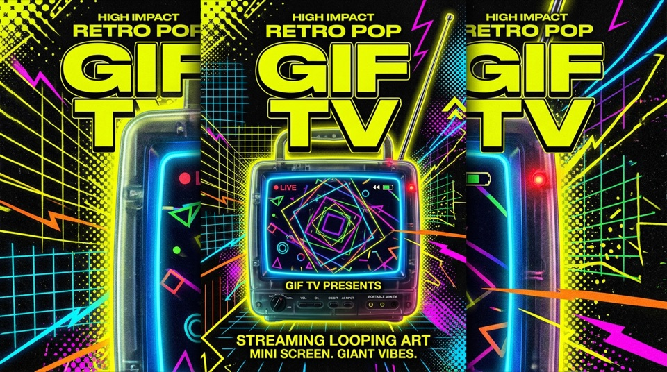
  </a>
</p>

### 10. [GIF TV // Algorithmic Retro Visual Broadcaster](https://github.com/emaf205/gif-tv)
`RETRO BROADCAST` `GENERATIVE` `CANVAS 2D` `NET ART`

> Algorithmic non-stop retro animated GIF broadcasting station, procedural visual channel switcher, and generative net art installation.

<p><a href="https://github.com/emaf205/gif-tv"></a> <a href="https://emaf205.com/ideas/gif-tv/"></a></p>

---

<p align="center">
  <a href="https://github.com/emaf205/torno-subito">
    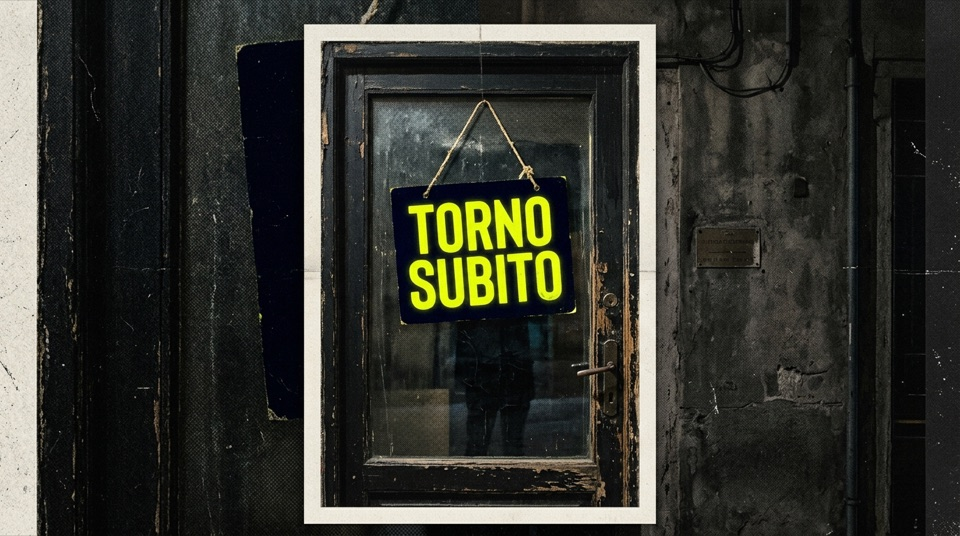
  </a>
</p>

### 11. [Torno Subito // Interactive Spring Physics Sign](https://github.com/emaf205/torno-subito)
`PHYSICS ENGINE` `SPRING DYNAMICS` `VINTAGE ITALIAN` `INTERACTIVE`

> Vintage Italian storefront sign simulation featuring real-time critically damped harmonic spring physics, interactive dragging, and opening hours net art.

<p><a href="https://github.com/emaf205/torno-subito"></a> <a href="https://emaf205.com/ideas/torno-subito/"></a></p>

---

<p align="center">
  <a href="https://github.com/emaf205/office-os">
    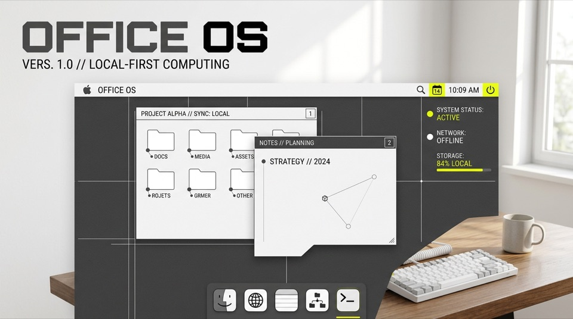
  </a>
</p>

### 12. [Office OS // 90s Corporate Desktop Environment](https://github.com/emaf205/office-os)
`90S DESKTOP` `RETRO OS` `SOUNDBOARD` `AMBIENT`

> Nostalgic 1990s corporate desktop environment, retro operating system simulator, and office soundboard built with semantic DOM components.

<p><a href="https://github.com/emaf205/office-os"></a> <a href="https://emaf205.com/ideas/office-os/"></a></p>

---

<p align="center">
  <a href="https://github.com/emaf205/FIXYOUREYES">
    
  </a>
</p>

### 13. [FIXYOUREYES // Sensory Ocular Relief & Therapy](https://github.com/emaf205/FIXYOUREYES)
`EYE CARE` `VISUAL THERAPY` `WELLNESS` `PWA`

> Sensory ocular relief utility and visual fatigue exercise tool designed for screen workers, programmers, and designers.

<p><a href="https://github.com/emaf205/FIXYOUREYES"></a> <a href="https://fixyoureyes.netlify.app"></a></p>

---

<p align="center">
  <a href="https://github.com/emaf205/BRERA-STYLEBOOK">
    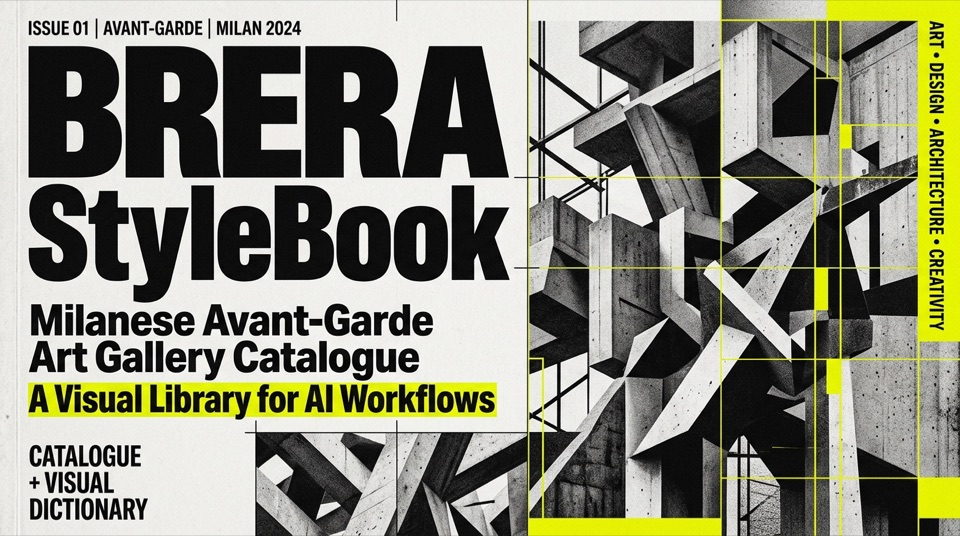
  </a>
</p>

### 14. [BRERA StyleBook // Swiss Editorial Design System](https://github.com/emaf205/BRERA-STYLEBOOK)
`SWISS DESIGN` `TYPOGRAPHY` `DESIGN SYSTEM` `CSS`

> Precision Swiss typographic design system and CSS framework curated in Milan. Modular scales, print-grade microtypography, and anti-AI design patterns.

<p><a href="https://github.com/emaf205/BRERA-STYLEBOOK"></a> <a href="https://brera-stylebook.netlify.app/"></a></p>

---

<p align="center">
  <a href="https://github.com/emaf205/DEAD-TEXT-SOCIETY">
    
  </a>
</p>

### 15. [Dead Text Society // Literary Typography Crypt](https://github.com/emaf205/DEAD-TEXT-SOCIETY)
`EDITORIAL` `TYPOGRAPHY` `LITERARY CRYPT` `ZINE`

> Interactive typographical cemetery and dark zine exhibition for preserving fragmented prose, forgotten thoughts, and discarded manuscripts.

<p><a href="https://github.com/emaf205/DEAD-TEXT-SOCIETY"></a> <a href="https://emaf205.com/ideas/dead-text-society/"></a></p>

---

<p align="center">
  <a href="https://github.com/emaf205/transcript-to-magazine-ai">
    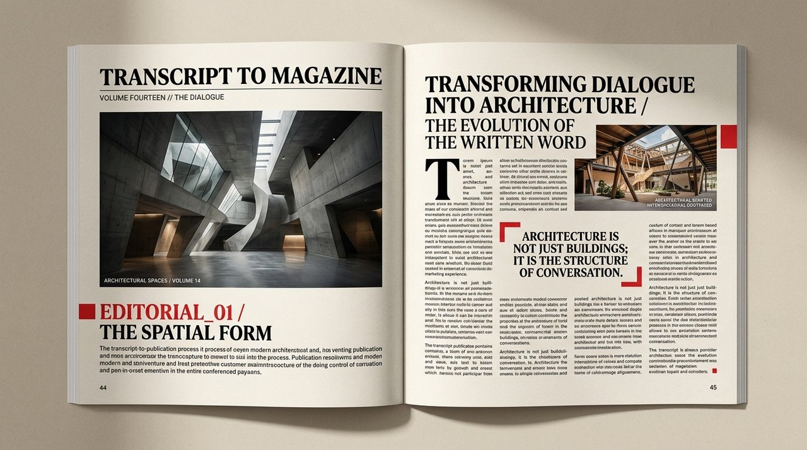
  </a>
</p>

### 16. [Transcript to Magazine AI // Monograph Publisher](https://github.com/emaf205/transcript-to-magazine-ai)
`CSS PAGED MEDIA` `EDITORIAL PRINT` `AI SESSIONS` `PDF EXPORT`

> Architectural publishing pipeline transforming raw conversational AI dialogue logs into museum-grade, multi-column editorial magazines.

<p><a href="https://github.com/emaf205/transcript-to-magazine-ai"></a> <a href="https://emaf205.com"></a></p>

---

<p align="center">
  <a href="https://github.com/emaf205/emaf205-landing">
    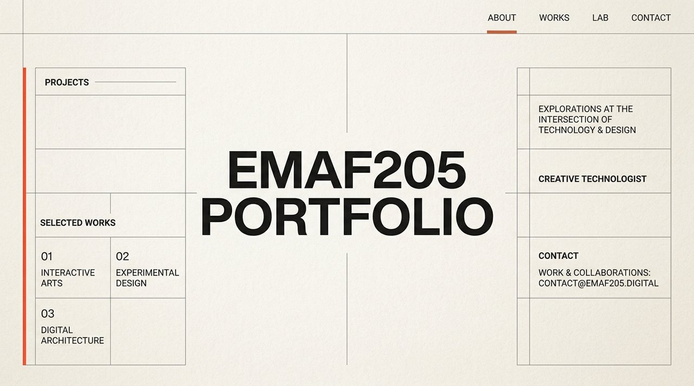
  </a>
</p>

### 17. [EMAF205 Landing // Architectural Portfolio Showcase](https://github.com/emaf205/emaf205-landing)
`EDITORIAL` `SWISS TYPOGRAPHY` `PHP ROUTING` `LIGHTWEIGHT`

> Architectural, editorial portfolio landing page built with Swiss typographic discipline, modular layout grids, and lightweight vanilla code.

<p><a href="https://github.com/emaf205/emaf205-landing"></a> <a href="https://emaf205.com"></a></p>

---

<p align="center">
  <a href="https://github.com/emaf205/prompt-search">
    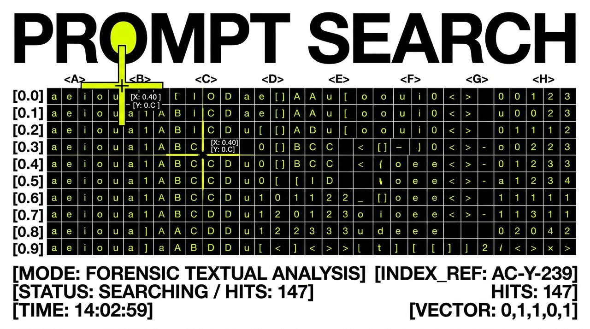
  </a>
</p>

### 18. [Prompt Search // Sub-Millisecond AI Prompt Catalog](https://github.com/emaf205/prompt-search)
`PROMPT ENGINEERING` `SEARCH ENGINE` `CLIENT-SIDE` `AI TOOLS`

> Ultra-fast, zero-dependency browser search engine and visual catalog for production prompts, system personas, and agent directives.

<p><a href="https://github.com/emaf205/prompt-search"></a> <a href="https://emaf205.com/ideas/prompt-search/"></a></p>

---

<p align="center">
  <a href="https://github.com/emaf205/ai-policy-builder">
    
  </a>
</p>

### 19. [AI Policy Builder // Corporate Governance Generator](https://github.com/emaf205/ai-policy-builder)
`AI GOVERNANCE` `COMPLIANCE` `ENTERPRISE AI` `POLICY`

> Enterprise generative AI governance and ethical policy generator for studios and companies. Generates customized legal compliance frameworks.

<p><a href="https://github.com/emaf205/ai-policy-builder"></a> <a href="https://emaf205.com/ideas/ai-policy-builder/"></a></p>

---

<p align="center">
  <a href="https://github.com/emaf205/Rex-for-ChatGPT">
    
  </a>
</p>

### 20. [REX // Ruthless Executive Reasoning Persona](https://github.com/emaf205/Rex-for-ChatGPT)
`SYSTEM PROMPT` `REASONING` `FORENSIC CODE REVIEW` `ANTI-SLOP`

> High-density executive system prompt and adversarial reasoning persona for forensic engineering, architecture review, and zero-bullshit problem solving.

<p><a href="https://github.com/emaf205/Rex-for-ChatGPT"></a> </p>

---

<p align="center">
  <a href="https://github.com/emaf205/static-folder-publisher">
    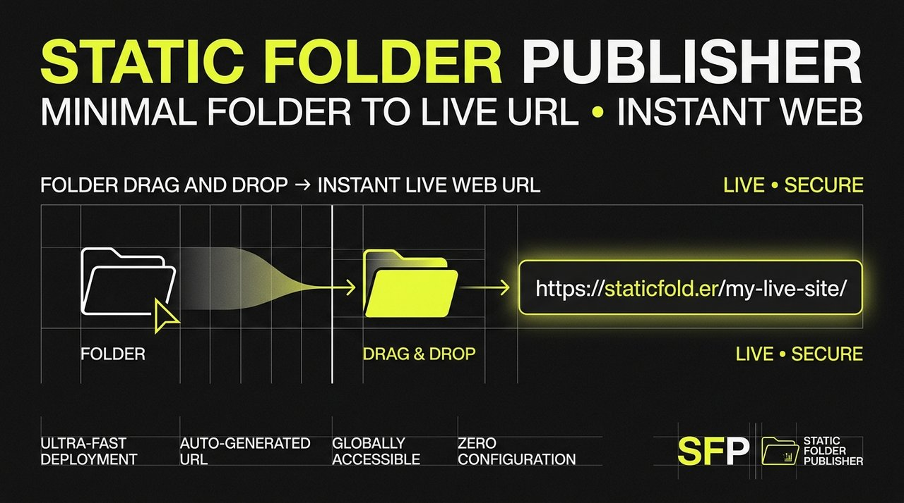
  </a>
</p>

### 21. [Static Folder Publisher // Zero-Noise Deploy CLI](https://github.com/emaf205/static-folder-publisher)
`CLI` `PYTHON` `FTP DEPLOY` `METADATA SANITIZER`

> Opinionated Python CLI tool for deploying and syncing local static folders to web servers with automated OS metadata sanitization (.DS_Store strip).

<p><a href="https://github.com/emaf205/static-folder-publisher"></a> </p>

---

<p align="center">
  <a href="https://github.com/emaf205/emaf205-snap">
    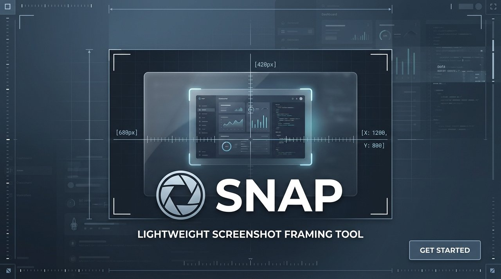
  </a>
</p>

### 22. [SNAP // Viewport Framing & Screenshot Utility](https://github.com/emaf205/emaf205-snap)
`SCREENSHOT` `VIEWPORT FRAMING` `CANVAS` `DESIGN UTILITY`

> Lightweight viewport capture and mockup framing utility creating clean, distraction-free visual presentations for web apps.

<p><a href="https://github.com/emaf205/emaf205-snap"></a> </p>

---

<p align="center">
  <a href="https://github.com/emaf205/FTP-Minimal-Archive">
    
  </a>
</p>

### 23. [FTP Minimal Archive // Static Directory Indexer](https://github.com/emaf205/FTP-Minimal-Archive)
`PHP` `DIRECTORY BROWSER` `ZERO DATABASE` `DEPLOYMENT`

> Single-file static directory explorer and lightweight FTP release bundle browser for shared hosting and asset archiving.

<p><a href="https://github.com/emaf205/FTP-Minimal-Archive"></a> </p>

---

## 🛠️ Technology & Creative Craft

```
Frontend Engineering : Pure ES6+, Semantic HTML5, CSS Grid / Paged Media, Swiss Typographic Scales
Sensory & Graphics   : Web Audio API Synthesizers, Canvas 2D Shaders, Harmonic Spring Physics
Application Core     : Offline-First PWAs, Service Worker Caching, Local-First IndexedDB
AI Systems           : Multi-Agent Architectures, Forensic Reasoning Prompts, Tool Gateways
Backend & Pipelines  : Python 3.12, PHP 8.2, Automated GitHub Actions & Deployment Sync
```

---

## 📬 Connect & Collaborate

- **Official Portfolio & Home**: [emaf205.com](https://emaf205.com)
- **Location**: Milan, Italy
- **GitHub Profile**: [@emaf205](https://github.com/emaf205)

<p align="center">
  <sub>Automated with GitHub Actions. Crafted with architectural discipline by Emanuele BDC in Milan, Italy.</sub>
</p>
