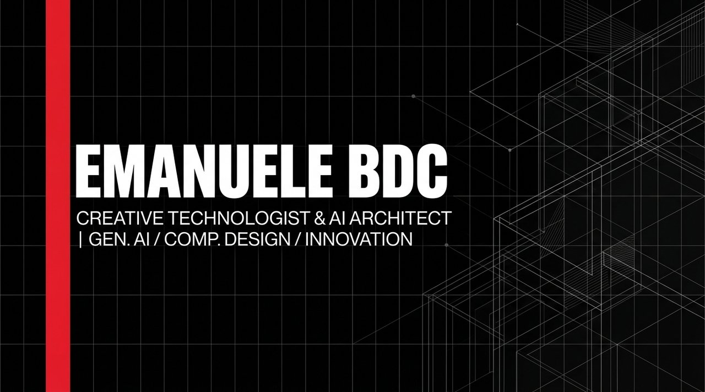

<p align="center">
  
</p>

<h1 align="center">Emanuele BDC (EmaF205)</h1>
<p align="center">
  <b>Creative Technologist & AI Systems Architect</b><br>
  <i>Milan, Italy // Designing generative systems, client-first web tools, and editorial architectures.</i>
</p>

<p align="center">
  <a href="https://emaf205.com/github"></a>
  <a href="https://emaf205.com"></a>
  <a href="https://github.com/emaf205"></a>
</p>

---

## 🏛️ Architectural Manifesto & Philosophy

I build digital software at the intersection of **classical design discipline** and **frontier artificial intelligence**:

- **Anti-AI Slop & Ruthless Simplicity**: No gratuitous gradients, no neon chatbot clichés, no empty tech hype. Every layout, typography decision, and interaction is engineered with intention, structural clarity, and Swiss graphic design rigor.
- **Client-Side Sovereignty**: Prioritizing zero-cloud, offline-first web apps. If computation can be executed privately and instantaneously in the user's browser (IndexedDB, Web Audio, Canvas, Service Workers), it never touches a remote server.
- **Zero Heavy Framework Bloat**: Pure vanilla modern web standards (ES6+, modern CSS custom properties, native Web APIs). High performance, instant loading (<100ms), and near-zero dependency debt.
- **Forensic Execution**: Designing agentic workflows and automated pipelines that operate with mathematical rigor, evidence-based verification, and zero tolerance for defect.

---

## 🚀 Selected Repositories & Open Source Systems

| Project | Description | Live Demo / Access |
| :--- | :--- | :--- |
| **[github](https://github.com/emaf205/github)** | **GitHub Repo Linktree & Mini Website Engine** — Responsive mobile Masonry & 3D Swipe Deck. | [Live Engine](https://emaf205.com/github) |
| **[silvo-tv](https://github.com/emaf205/silvo-tv)** | Interactive retro cathode-ray tube (CRT) television simulator with tactile knobs & scanlines. | [Live TV](https://emaf205.com/ideas/silvo-tv) |
| **[BRERA-STYLEBOOK](https://github.com/emaf205/BRERA-STYLEBOOK)** | High-end Swiss typographic design system & CSS framework curated in Milan. | [Stylebook](https://emaf205.com/github) |
| **[FIXYOUREYES](https://github.com/emaf205/FIXYOUREYES)** | Sensory ocular relief utility & dynamic visual fatigue exercise tool for screen workers. | [Launch Tool](https://emaf205.com/ideas/fixyoureyes) |
| **[ai-policy-builder](https://github.com/emaf205/ai-policy-builder)** | Enterprise generative AI governance, ethics guidelines & compliance document generator. | [Open Builder](https://emaf205.com/ideas/ai-policy-builder) |
| **[SIMPLE-PDF-SIGN](https://github.com/emaf205/SIMPLE-PDF-SIGN)** | 100% client-side cryptographic PDF signing & digital document stamping utility. | [Sign PDF](https://emaf205.com/ideas/simple-pdf-sign) |
| **[DEAD-TEXT-SOCIETY](https://github.com/emaf205/DEAD-TEXT-SOCIETY)** | Interactive literary zine, editorial cemetery & dark typographical crypt. | [Read Zine](https://emaf205.com/ideas/dead-text-society) |
| **[ai-diary](https://github.com/emaf205/ai-diary)** | Local-first encrypted reflection journal & mood tracker with offline IndexedDB storage. | [Open Diary](https://emaf205.com/ideas/ai-diary) |
| **[emaf205-tapetone](https://github.com/emaf205-tapetone)** | Analog cassette tape simulator & warm acoustic saturation synthesizer via Web Audio API. | [Play Tape](https://emaf205.com/ideas/tapetone) |
| **[office-os](https://github.com/emaf205/office-os)** | Ambient 90s corporate desktop environment, retro operating system & soundboard. | [Boot OS](https://emaf205.com/ideas/office-os) |
| **[gif-tv](https://github.com/emaf205/gif-tv)** | Algorithmic retro animated GIF television channel & broadcast visual experiment. | [Tune In](https://emaf205.com/ideas/gif-tv) |
| **[torno-subito](https://github.com/emaf205/torno-subito)** | Tactile vintage Italian storefront sign simulator with interactive physical wobble. | [View Sign](https://emaf205.com/ideas/torno-subito) |
| **[EMAF205-Easy-ChatGPT-Importer](https://github.com/emaf205/EMAF205-Easy-ChatGPT-Importer)** | Offline OpenAI archive reader, search indexer & JSON-to-Markdown exporter. | [Import Archive](https://emaf205.com/ideas/chatgpt-importer) |
| **[transcript-to-magazine-ai](https://github.com/emaf205/transcript-to-magazine-ai)** | Transcripts to architectural monograph & multi-column print publication engine. | [View Engine](https://emaf205.com/github) |
| **[kurt-cobain-street-critic](https://github.com/emaf205/kurt-cobain-street-critic)** | Lo-fi 90s grunge zine simulator & satirical street art cultural critic game. | [Play Critic](https://emaf205.com/ideas/kurt-critic) |

---

## 🛠️ Creative Technology Stack

```
Frontend & Design  : Vanilla ES6+, Semantic HTML5, CSS Grid / Paged Media, Swiss Typographic Systems
Audio & Graphics   : Web Audio API, Canvas 2D, Procedural Shaders, Physical Springs
Architectural Core : Offline-First PWAs, Service Workers, IndexedDB, Local-First Sovereignty
AI Orchestration   : Multi-Agent Architectures, Prompt Calibration, Agentic Tool Gateways
Backend & Devops   : Python 3.12, PHP 8.2, Automated FTP / Netlify Deploy Pipelines
```

---

## 📬 Contact & Collaborations

- **Official Portfolio**: [emaf205.com/github](https://emaf205.com/github)
- **Primary Website**: [emaf205.com](https://emaf205.com)
- **Location**: Milan, Italy
- **GitHub**: [@emaf205](https://github.com/emaf205)

<p align="center">
  <sub>© Emanuele BDC (EmaF205). Crafted with architectural rigor in Milan, Italy.</sub>
</p>
